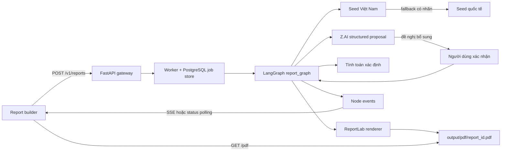
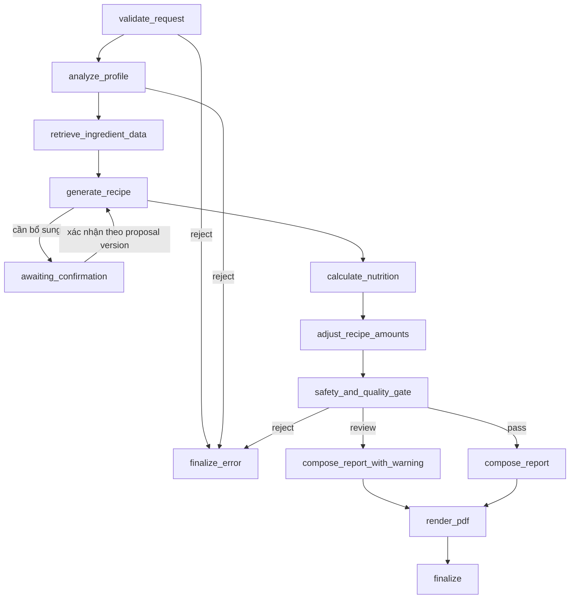

# Kiến trúc và luồng dữ liệu

## Các node theo ngôn ngữ nghiệp vụ

| Node | Nhận | Trả về | Có thể retry |
|---|---|---|---|
| `validate_request` | hồ sơ, IDs nguyên liệu | nguyên liệu đã resolve, lỗi dị ứng/dữ liệu thiếu | Không |
| `analyze_profile` | hồ sơ hợp lệ | mục tiêu và cờ cần chuyên gia | Không |
| `retrieve_ingredient_data` | nguyên liệu đã chọn | số liệu/nguồn trên 100 g | Có, tối đa 3 |
| `generate_recipe` | nguyên liệu và mục tiêu | định lượng, tối đa 6 bước | Có, tối đa 2 |
| `calculate_nutrition` | định lượng + dữ liệu nguồn | tổng và đóng góp từng nguyên liệu | Không; code xác định |
| `adjust_recipe_amounts` | phép tính có ngưỡng `review` | định lượng mới (giữ nguyên nguyên liệu, trong giới hạn ≤400 g/≤600 ml), tối đa 2 vòng; bỏ qua khi thiếu dữ liệu | Không; code xác định |
| `safety_and_quality_gate` | phép tính + hồ sơ | `pass`, `review` hoặc `reject` | Không |
| `compose_report*` | toàn bộ kết quả | `NutritionReportDocument` độc lập PDF | Không |
| `render_pdf` | report document | PDF metadata/hash | Không |
| `finalize*` | state cuối | thời gian hoàn tất hoặc từ chối | Không |

## Quy tắc dữ liệu

Seed Việt Nam ở `backend/data/vietnamese_fruits_seed.json` được nạp trước. `backend/app/data/report_nutrition_fallback.json` chỉ bổ sung nguyên liệu hỗ trợ và luôn ghi nhãn nguồn quốc tế. Giá trị thiếu giữ `null`; nó làm giảm `data_coverage` và chuyển report sang `review`, không được LLM hay renderer điền đoán.

Tất cả tổng dinh dưỡng được tính theo công thức `giá trị trên 100 g × gram thực tế / 100 / số khẩu phần`. Giá trị ml chỉ được tính khi dữ liệu có basis trên 100 ml hoặc có mật độ và nguồn; nếu thiếu, chất dinh dưỡng liên quan giữ `null` và report chuyển sang `review`. Threshold trong `backend/app/data/report_thresholds.json` là ngưỡng thử nghiệm, không nằm trong prompt.
